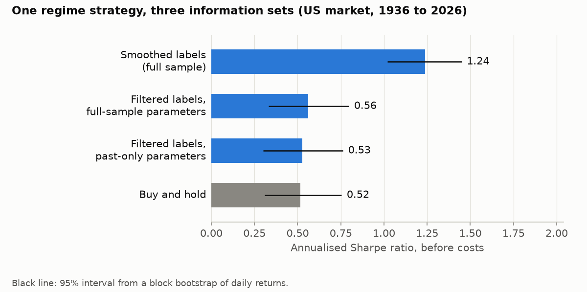
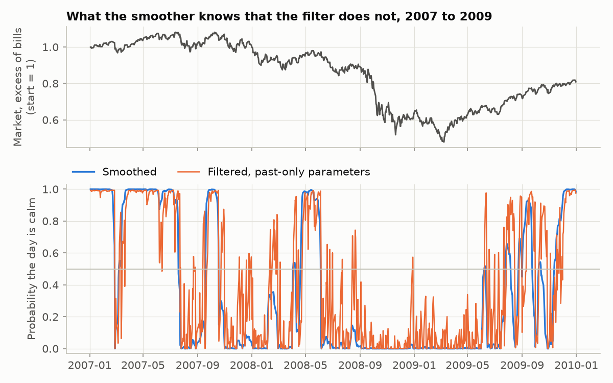
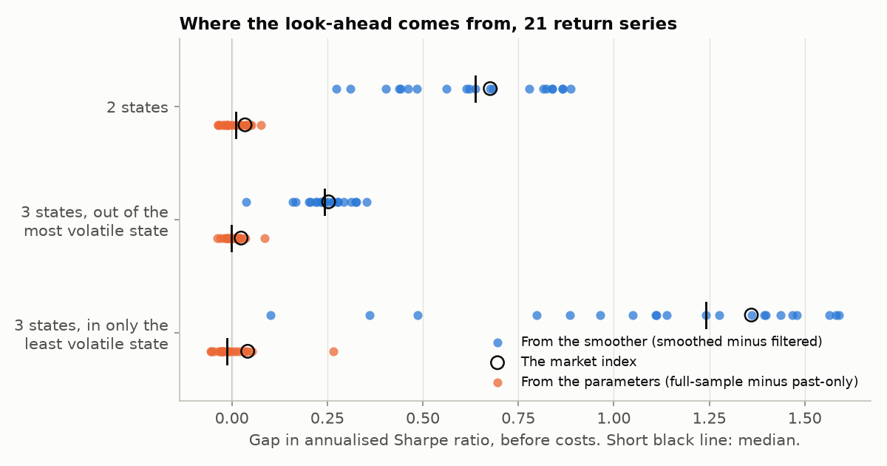

# Hindsight

[](https://github.com/mal0ware/hindsight/actions/workflows/ci.yml)

**How much of a regime-switching backtest is the model, and how much is knowing the future?**

On 90 years of daily US market returns, a two-state regime strategy has a Sharpe ratio of 1.24 when it trades on smoothed labels and 0.53 when the model only knows the past. Buy and hold scores 0.52 over the same days. Of the 0.71 gap, 0.68 comes from the smoother reading later days and 0.03 from fitting the parameters on the full sample. The 0.03 is not distinguishable from zero.

The same split on 21 return series (the market, ten industries, ten size deciles) gives a smoother gap between 0.27 and 0.89, with a median of 0.64. It is positive on every series. The past-only version beats buy and hold on 7 of the 21.



The main limit: all 21 series are US equity portfolios over the same 90 years, so they are 21 views of one history. The spread across them says how much the gap depends on the portfolio. It is not a confidence interval.

## The question

A hidden Markov model labels each day calm or turbulent. Many backtests use labels computed from the full history. How much of the reported performance disappears when the model only knows what it could have known?

## Reproduce

```
uv sync
uv run python scripts/fetch_data.py
uv run python scripts/reproduce.py
```

The full run fits about 93,000 small models and uses every CPU. On a 32-thread desktop it took 24 minutes on one run and 45 on another, when the machine was busy with other work. It rewrites every file in `results/`. `uv run python scripts/reproduce.py --fast` runs a smaller version in about a minute and writes to `results_fast/`.

## The result on the market index

The strategy holds the market tomorrow if today is labelled calm, and holds bills otherwise. The calm state is the low-volatility state of a two-state Gaussian model fitted to daily excess returns. All versions are scored on the same 23,337 days, 1936-08-01 to 2026-09-30, before costs.

| Labels | Sharpe | 95% interval, model refitted | 95% interval, labels fixed | Switches | Sharpe at 10 bp per switch |
| --- | --- | --- | --- | --- | --- |
| Smoothed (full sample) | 1.24 | 1.00 to 1.60 | 1.02 to 1.45 | 418 | 1.19 |
| Filtered, full-sample parameters | 0.56 | 0.31 to 0.80 | 0.33 to 0.80 | 1,312 | 0.42 |
| Filtered, past-only parameters | 0.53 | 0.31 to 0.82 | 0.30 to 0.76 | 1,372 | 0.38 |
| Buy and hold | 0.52 | 0.21 to 0.70 | 0.31 to 0.75 | 0 | 0.52 |

| Gap in Sharpe ratio | Value | 95% interval, model refitted | 95% interval, labels fixed |
| --- | --- | --- | --- |
| Total: smoothed minus past-only | 0.71 | 0.57 to 0.94 | 0.58 to 0.84 |
| From the smoother: smoothed minus filtered | 0.68 | 0.57 to 0.93 | 0.54 to 0.81 |
| From the parameters: full-sample minus past-only | 0.03 | -0.05 to 0.06 | -0.02 to 0.09 |

The two kinds of interval answer different questions, and the section "What the intervals cover" below explains both. The chart at the top uses the refitted ones.

The smoothed version is in the market on 79.8% of days and the past-only version on 80.8%, and the two agree on the label for 92.7% of days. The whole difference in Sharpe ratio comes from the remaining 7.3%, which sit around regime changes. In the chart below the smoothed probability moves ahead of the filtered one at the start and end of turbulent spells, because it has seen the days that follow. The filtered probability also jumps back and forth inside a spell, so the filtered labels switch three times as often.



After costs of 10 basis points per switch the past-only version (0.38) is below buy and hold (0.52). Its largest drawdown is 60%, against 55% for buy and hold and 24% for the smoothed version. Drawdowns are measured on total returns, the excess return plus the bill rate. `results/performance.csv` also has them on excess returns.

A backtest that also lets today's smoothed label earn today's return, with no one-day lag, reports 1.60.

By thirds of the evaluation period:

| Labels | 1936-1964 | 1964-1995 | 1995-2026 |
| --- | --- | --- | --- |
| Smoothed | 1.35 | 0.83 | 1.57 |
| Filtered, full-sample parameters | 0.84 | 0.35 | 0.51 |
| Filtered, past-only parameters | 0.69 | 0.39 | 0.51 |
| Buy and hold | 0.71 | 0.36 | 0.51 |

### Trading one day later

The numbers above assume the trade happens at the same close that produced the label. That is optimistic, because the label needs that close as an input. The table repeats the run with the trade one close later, so the label of day `t` earns the return of day `t + 2`.

| Labels | Same close | One day later |
| --- | --- | --- |
| Smoothed (full sample) | 1.24 | 1.02 |
| Filtered, full-sample parameters | 0.56 | 0.55 |
| Filtered, past-only parameters | 0.53 | 0.52 |

The delay costs the smoothed version 0.22 and the past-only version 0.01. The total gap falls from 0.71 to 0.50 and the smoother's share from 0.68 to 0.47. So about a third of the smoother's advantage was earned on the first day after each label, and two thirds survive a day's wait. `results/execution_delay.csv` has the Wasserstein versions too.

### Other series and three states

The market index is one series, and two states is one model. This section repeats the split on 21 series from the French library and adds a three-state model. With three states there are two natural rules, and both are reported: hold unless the most volatile state is more likely than not, or hold only when the least volatile state is more likely than not. I wrote both rules down before running either.



| Model and rule | Smoother gap: median (range) | Parameter gap: median (range) | Series where past-only beats buy and hold |
| --- | --- | --- | --- |
| 2 states | 0.64 (0.27 to 0.89) | 0.01 (-0.04 to 0.08) | 7 of 21 |
| 3 states, out of the most volatile state | 0.24 (0.04 to 0.35) | -0.00 (-0.04 to 0.09) | 18 of 21 |
| 3 states, in only the least volatile state | 1.24 (0.10 to 1.59) | -0.01 (-0.06 to 0.27) | 14 of 21 |

The smoother gap is positive in all 63 cases. Its size depends a great deal on the rule. A rule that only leaves the market in the most volatile of three states trades rarely and gains least from hindsight. A rule that holds only in the calmest of three states switches often and gains most. The size deciles show larger two-state gaps (0.62 to 0.89) than the industries (0.27 to 0.68).

The parameter gap is small everywhere, and its sign is close to a coin flip: positive on 12, 10 and 8 of the 21 series under the three rules. The one large value, 0.27, is the smallest size decile under the calmest-state rule.

Past-only against buy and hold is mixed. The median difference in Sharpe ratio is -0.01, 0.02 and 0.07 under the three rules, before costs. I did not test whether any of these differ from zero, and the three-state rules were added after the two-state result was known, so the 18 of 21 should be read as a description.

With the trade one day later the two-state smoother gap has a median of 0.41 (0.14 to 0.63) and is still positive on every series. Across all three rules it is positive in 62 of 63 cases. The exception is the telecom industry under the calmest-state rule, at -0.07. Per-series numbers: `results/cross_section.csv`. Summary: `results/cross_section_summary.csv`.

### What the intervals cover

The "labels fixed" intervals come from 2,000 circular block bootstrap resamples of the daily strategy returns, with 63-day blocks. The labels are computed once and held fixed. These intervals describe noise in returns given the labels and leave out the uncertainty in the model.

The "model refitted" intervals put that uncertainty back. Each of 500 resamples is a stationary bootstrap of the raw return series (mean block 63 days). On each one the full-sample model is fitted again, the smoother and filter are rerun, and the past-only parameters are refitted. To keep this affordable the past-only refits are yearly inside the bootstrap, against monthly for the point estimates, and scoring starts in January 1937, five months later. On the real data the yearly schedule gives 1.24, 0.56 and 0.51, against 1.24, 0.56 and 0.53 monthly.

The refitted intervals are wider for the smoothed version (1.00 to 1.60 against 1.02 to 1.45) and similar for the filtered ones. For the parameter gap the refitted interval is -0.05 to 0.06 and 46% of resamples are at or below zero. With the labels fixed that share was 8%. Neither share is a p-value, because the resamples are not drawn under a hypothesis of no gap. Read together, they say the parameter gap on this series cannot be told from zero.

A resample scrambles the order of the blocks, so the 1929 to 1933 crash no longer always sits in the burn-in period. The refitted interval for the parameter gap therefore describes a history where the early sample is typical of the rest.

The intervals for the Wasserstein versions and for the one-day delay are of the fixed-label kind only. The cross-section has no intervals.

### The same split for Wasserstein k-means

Windows of 35 daily returns, starting 7 days apart, clustered into two groups by 1-Wasserstein distance. Intervals are with the labels held fixed, so they understate the uncertainty.

| Labels | Sharpe | 95% interval, labels fixed |
| --- | --- | --- |
| From every window containing the day, full-sample centroids | 1.24 | 1.02 to 1.46 |
| Trailing window, full-sample centroids | 0.54 | 0.29 to 0.78 |
| Trailing window, past-only centroids | 0.58 | 0.34 to 0.82 |

Labelling a day by every window that contains it is how the paper colours a price path. Those windows run up to 34 days past the day, and that is where the 1.24 comes from. With a trailing window the method scores about the same as buy and hold, whichever centroids it uses.

## Checks on the fits

Every EM fit records whether it met its stopping rule, and the run stops with an error if one does not. All 1,083 fits behind the market result converged, the slowest in 58 iterations. All 45,486 fits in the cross-section and all 45,500 in the refitted bootstrap converged too (`results/em_convergence.csv`, `results/cross_section.csv`).

EM can stop at a local maximum. For each of the 21 series, with two and with three states, the full-sample model was refitted from 20 random starting points. In all 42 cases the usual deterministic start reached the highest likelihood found, and no random start found a higher one (`results/em_multistart.csv`). The check covers the full-sample fits only. The past-only refits use the deterministic start and were not restarted.

## What was built

- Hamilton's filter and the backward smoother usually credited to Kim, written from scratch in `src/hindsight/filter.py` and checked against statsmodels and against a sum over every state path.
- A Gaussian switching model with two or three states, fitted by EM (`model.py`).
- Hamilton's 1989 GNP model with four autoregressive lags, run through the same filter (`hamilton1989.py`).
- One strategy run three ways (`strategy.py`): smoothed labels; filtered labels with full-sample parameters; filtered labels with parameters refitted each month on the past only.
- Wasserstein k-means on rolling return distributions (`wasserstein.py`), with the same three-way split.

## Sources

- Hamilton, "A New Approach to the Economic Analysis of Nonstationary Time Series and the Business Cycle", Econometrica 57(2), 1989
- Hamilton, "Macroeconomic Regimes and Regime Shifts", NBER Working Paper 21863, 2016 (the vector form of the filter, the smoother and the EM updates were read here)
- Kim, "Dynamic linear models with Markov-switching", Journal of Econometrics 60(1-2), 1994 (paywalled; not read)
- Horvath, Issa and Muguruza, "Clustering market regimes using the Wasserstein distance", arXiv:2110.11848; Journal of Computational Finance 28(1), 2024

## Comparison with the sources

Full detail, formulas and equation numbers are in `PAPER.md`.

- Hamilton (1989), Table I: all nine estimates reproduce to within 0.0011, and the standard errors to within 0.0007.
- Hamilton (1989), Table II: all seven recessions dated by the smoother match, quarter for quarter.
- Hamilton (1989), expected durations: 4.08 quarters for a recession (paper 4.1) and 10.43 for an expansion (paper 10.5).
- Horvath, Issa and Muguruza, Table 3: Wasserstein k-means labels 90.4% of synthetic returns correctly (paper 90.6%).
- The headline result, the Sharpe ratio under three information sets, is not in any of the sources.

### The paper's 58% for a hidden Markov model

The same Table 3 reports 58.2% accuracy for a hidden Markov model. The model fitted here scores 99.5% on the same kind of path. The paper says it fits "a Gaussian HMM" and gives no software, starting values or stopping rule, so I tried fits that are weaker on purpose. This was done after the first results, to explain the difference.

| Fit, 50 synthetic paths | Total accuracy | Regime-on | Regime-off |
| --- | --- | --- | --- |
| Paper, HMM | 58.2% | 41.5% | 63.7% |
| EM run to convergence (this repository) | 99.5% | 98.9% | 99.7% |
| Usual start, stopped after 10 iterations | 33.3% | 99.8% | 11.1% |
| Start split by mean, variance inflated, at most 10 iterations | 52.3% | 58.3% | 50.3% |
| Start split by mean, at most 10 iterations | 63.6% | 38.1% | 72.1% |
| Start split by mean, variance inflated, run to convergence | 99.5% | 98.9% | 99.7% |
| Model fitted to the log price instead of returns | 47.8% | 62.6% | 42.8% |

A fit stopped early does about as badly as the paper's. Starting EM with the two states split by mean and stopping after 10 iterations gives 63.6% in total, 38.1% regime-on and 72.1% regime-off, which is the paper's pattern. The same start run to convergence gives 99.5%, so the starting point is not the problem. Ten iterations and a mean-split start are the defaults of hmmlearn's `GaussianHMM`, a common Python library, though the paper does not say what it used and this does not show that it used those. The regimes in this test differ in volatility and hardly at all in mean, so a fit that has not yet moved off a mean split cannot find them. Details are in `PAPER.md`.

## Data

Daily returns from the Kenneth R. French data library, 1926-07-01 to 2026-09-30, 26,338 days, in three files: the market excess return (`Mkt-RF`) with the one-month bill rate, ten value-weighted industry portfolios, and ten value-weighted size deciles. The portfolio files give total returns and the bill rate is subtracted here. The files are free to download without a key, are copyright Fama and French, and are fetched by `scripts/fetch_data.py` into `data/`, which is not committed. `results/sample.csv` records the SHA-256 of each file used.

The 135 quarterly GNP growth rates for Hamilton's model are not in this repository. An earlier commit shipped them as `src/hindsight/rgnp_growth.csv`, copied from the Stata Press example file `rgnp.dta`. The Stata Press page gives no licence for its datasets and says "Do not use these datasets for analysis", so the file was removed from the tree. It is still in the git history. The code now reads the same 135 numbers from the test module of statsmodels, a pinned dependency under the BSD 3-clause licence. The values agree with the removed file to seven decimals, and the Hamilton tables did not change at the four decimals shown.

## How it is tested

78 tests, run with `uv run pytest`. CI runs lint, type checks, the tests and the fast reproduce on every push.

- Filter and smoother match statsmodels to `1e-10` with two and three states, and match Hamilton's GNP model in statsmodels at the Table I estimates
- Filter, smoother and likelihood match a brute-force sum over all state paths on short samples
- The smoothed probability of the last day equals the filtered one
- Expected time in a state equals 1 / (1 - p), checked by formula, against Hamilton's printed 4.1 and 10.5 quarters, and against simulated run lengths
- EM never lowers the likelihood and ends where the likelihood is flat
- A fit cut off before convergence is flagged, and the experiment refuses to run on it
- Random EM starts reach the same maximum as the deterministic start on simulated data
- Changing returns after a date leaves every earlier past-only label unchanged, and changes the smoothed ones
- A one-day delay moves every position by exactly one day
- The cross-section on one series equals the single-series run, and does not depend on the number of worker processes
- 1-Wasserstein distance matches scipy; the barycenter beats 200 random perturbations
- Running the experiments twice gives identical tables

## Layout

```
src/hindsight/         the code
tests/                 maths tests first
scripts/reproduce.py   one command rebuilds every figure and table
scripts/fetch_data.py  downloads public data into data/ (never committed)
results/               committed figures and small tables
PAPER.md               citations, formulas, comparison with the sources, every variant run
```

## Limits

- The 21 series are all US equity portfolios over the same years and are highly correlated. Another asset class or country could give a different size of gap.
- The rule is always long or flat with a 0.5 threshold. Position sizing by probability, or a short side, was not tried.
- The one-day delay, the 21 series, the three-state model, the refitted bootstrap, the random starts and the weak HMM fits were all added after the first market result was written up, in response to a review. None of their settings was changed after seeing its result, but the choice to run them was made knowing the headline.
- The refitted bootstrap uses yearly refits, 500 resamples and the market series only. Block resampling also cuts regimes at block joins, which the intervals inherit.
- The parameter gap is small partly because the first refit already has ten years of data that include 1929 to 1933. Both volatility states were well observed by 1936. A sample that starts in a quiet decade would test parameter look-ahead harder.
- With three states the identity of a state can change from one past-only refit to the next. The labels follow the ordering by volatility at each refit and nothing checks that the states stay comparable.
- Costs are a flat 10 basis points per switch. Bills are assumed to earn the French library's risk-free rate with no spread.
- The smoother formula is taken from Hamilton (2016). Kim (1994) and Hamilton (1990) are paywalled and were not read.
- I searched for a published number for the smoothed-to-filtered gap and did not find one. That is not proof none exists.
- The full results were produced on Windows. CI runs the tests and the fast reproduce on Linux.
- This is research code. It is not investment advice and it does not trade.

The name: smoothed regime probabilities use days that had not happened yet, which is hindsight.

## Licence

MIT. See `LICENSE`.
